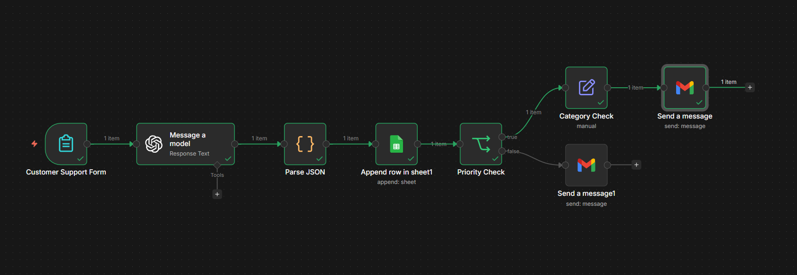

# Smart Customer Support Triage Agent

## Overview

This project is an AI-powered automation workflow built using n8n that triages incoming customer support tickets.

It analyzes each ticket using a large language model (LLM), classifies it by sentiment, category, and priority, and then routes or responds accordingly.

The goal is to reduce manual effort in ticket handling while improving response speed and consistency.

---

## Problem

Customer support teams often spend significant time manually reviewing and categorizing incoming tickets.

This process can be slow, inconsistent, and difficult to scale.

This project aims to automate the triage process by:

- Understanding customer messages
- Identifying urgency and issue type
- Routing tickets to the correct team
- Providing immediate responses when appropriate

---

## Solution

The system uses an LLM to analyze incoming tickets and integrates with automation workflows to handle decision-making and actions.

It performs:

- Sentiment analysis
- Issue categorization (technical, billing, feedback)
- Priority classification (low, medium, high)
- Response generation

---

## Architecture

The workflow follows four main stages:

1. **Intake**
   - Customer submits a ticket via form

2. **AI Analysis**
   - LLM processes the message and returns structured JSON

3. **Processing & Logging**
   - Parses AI output
   - Adds metadata (ticket ID, timestamp, status)
   - Stores all tickets in Google Sheets

4. **Decision & Action**
   - High-priority tickets are escalated to the appropriate department
   - Low/medium tickets receive automated responses

---

## Key Features

- AI-powered ticket classification
- Dynamic routing based on category
- Priority-based escalation system
- Automated customer replies
- Error handling for invalid AI responses
- Ticket logging for tracking and analysis

---

## Tech Stack

- n8n (workflow automation)
- OpenAI (LLM for analysis and response generation)
- Google Sheets (data storage)
- Gmail (notifications and responses)

---

## Example Flow

1. User submits a support request
2. AI analyzes and classifies the ticket
3. Ticket is logged with metadata
4. System decides:
   - High priority → escalate to team
   - Otherwise → send auto-reply

---

## Future Improvements

With more time and resources, this system can be extended by:

- Integrating a knowledge base for retrieval-based responses
- Adding analytics dashboards for ticket insights
- Implementing SLA-based prioritization
- Replacing Google Sheets with a production database
- Adding monitoring and retry mechanisms

---

## Notes

This implementation focuses on building a reliable and structured automation system.

It can be extended into a more autonomous agent by introducing tool-based decision-making and external integrations such as CRM systems or knowledge bases.
